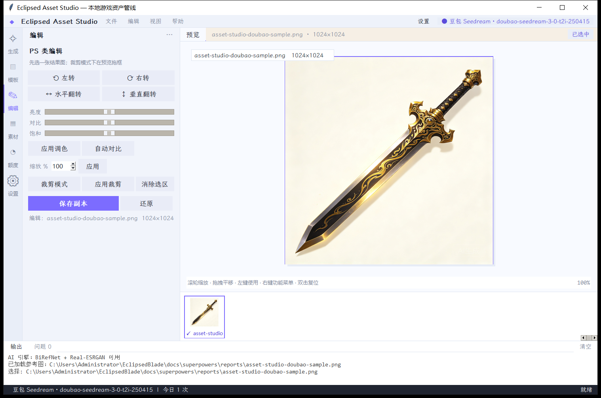
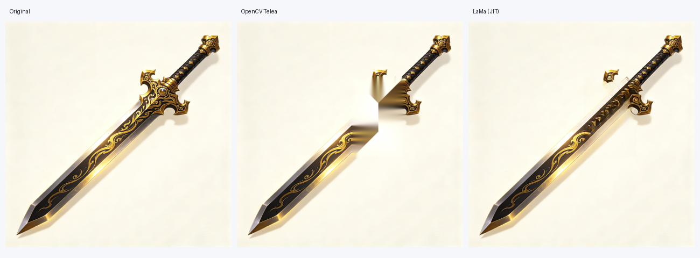

# EclipsedBlade

暗金古风**放置养成 RPG** + 本地 **AI 游戏资产管线**（Asset Studio）。

> 一个仓库，两件事：
> 1. **Cocos Creator 3.8.8 游戏**：宠物养成、技能三选一、放置/离线收益、技能试炼、图鉴、异步 PVP 的 MVP。
> 2. **Asset Studio**：本地桌面工具，AI 生图 → 抠图 → 超分 → 拆层 → 切图 → TexturePacker 图集 → PS 类编辑，一条龙产出游戏 UI 资产。



## 功能

### 游戏（MVP M1）
- 首次引导、主页、试炼三选一、技能页、5 页签导航
- 属性点/永久技能/受保护技能、技能试炼结算
- 安全/冒险放置、离线收益结算、腐蚀提示、蚀月倒计时
- 数据配置外置：`assets/resources/data/gameplay.json`
- 纯逻辑模块不依赖 `cc`，可用 `node --test` 覆盖

### Asset Studio
- **AI 生图**：豆包 Seedream / 阿里百炼 / OpenAI 兼容 / Mock；模型可自选、失败自动切换
- **图生图**：参考图拖拽、图推词、扩写
- **后处理**：BiRefNet 抠图、Real-ESRGAN 超分、拆图层、雪碧图切分
- **PS 类编辑**：旋转/翻转/调色/缩放/拖框裁剪/OpenCV 快速消除/**LaMa AI 消除**
- **图集打包**：MaxRects、旋转/POT/trim/extrude/多页，Cocos/Phaser/TexturePacker 三种 manifest
- **高 DPI 玻璃拟态界面**：私有加载霞鹜文楷，自定义玻璃光标、Toast、动效



## 目录

```
assets/                 Cocos 游戏脚本、场景、UI 资源
docs/superpowers/       GDD/PRD/计划/验收报告/截图
tests/                  纯逻辑测试（node --test）
tools/asset_studio/     Asset Studio（Python + Tkinter）
tools/build_asset_studio.ps1
```

## 运行游戏

1. 安装 Cocos Creator **3.8.8**
2. 打开本目录，运行 `Main.scene`
3. 逻辑测试：

```bash
tsc -p tsconfig.tests.json
node --test .test-dist/tests/*.test.js
```

## 运行 Asset Studio

```powershell
python -m venv .venv
.\.venv\Scripts\pip install -r tools\asset_studio\requirements.txt
.\.venv\Scripts\python -m asset_studio
```

打包 exe：

```powershell
powershell -ExecutionPolicy Bypass -File tools\build_asset_studio.ps1
```

### AI 依赖（按需，不随仓库分发）

- 抠图：BiRefNet ONNX（`rembg` 自动下载）
- 超分：Real-ESRGAN ncnn（放到 `tools/asset_studio/bin/realesrgan/`）
- AI 消除：`big-lama.pt`（首次点「AI 消除（LaMa）」自动下载约 196MB 到 `%APPDATA%\EclipsedAssetStudio\ai\models`）

API Key 只在应用设置里保存到本地 `%APPDATA%`，**不会写入仓库**。

## 技术栈

Cocos Creator 3.8.8 · TypeScript · Python 3.9 · Tkinter · Pillow · OpenCV · ONNX Runtime · PyTorch(cpu) · rectpack

## 许可

代码：MIT（见 [LICENSE](LICENSE)）。
字体/依赖/模型权重许可见 [THIRD_PARTY_NOTICES.md](THIRD_PARTY_NOTICES.md)。

游戏内美术资源仅作示例，发布前请替换为你拥有版权的素材。

## MCP 接入

Asset Studio 内置 **MCP Server**（stdio），Claude Desktop / Cursor / DSH 可直接调用生图、抠图、超分、LaMa 消除、编辑、Atlas 打包：

```powershell
python tools\asset_studio\mcp_server.py
```

客户端配置见 [`tools/asset_studio/MCP.md`](tools/asset_studio/MCP.md)。
