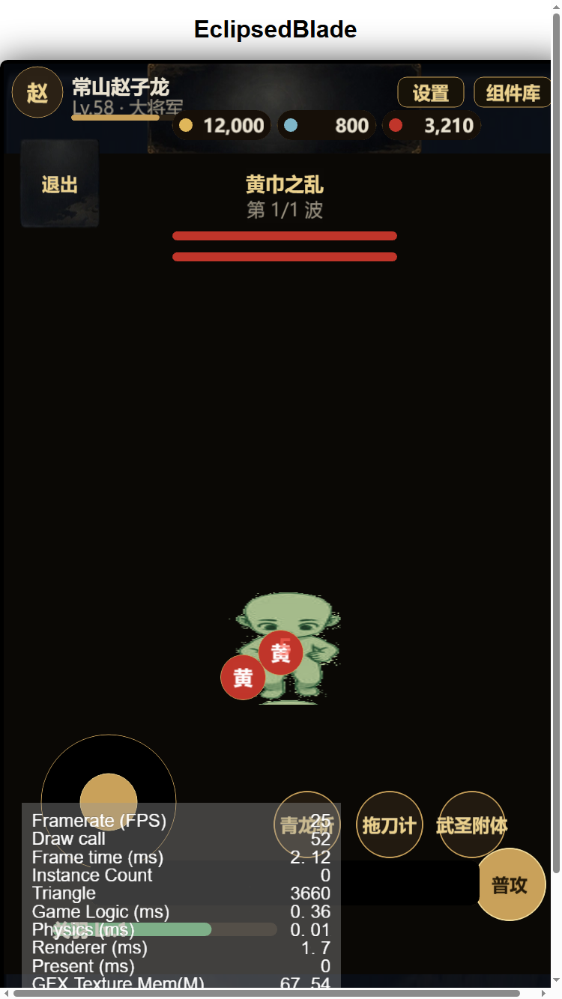

# 2D chibi 精灵管线报告

日期：2026-10-18
决策：放弃 3D 转 2D，回到 **2D 精灵 + 真正的 2D 美术**。

## 现有 2D 资产

| 目录 | 内容 |
|---|---|
| `assets/resources/char/refchibi/` | 你给的 5 视角 × 8 帧底模切出的 8 方向帧 |
| `assets/resources/char/chibi_guanyu/` | 关羽色板（深绿） |
| `assets/resources/char/chibi_zhaoyun/` | 赵云色板（白蓝） |
| `assets/resources/char/chibi_zhangfei/` | 张飞色板（黑金） |

每个角色：`idle` 8 帧、`walk` 8 帧、`attack` 8 帧 × 8 方向。

## 工具

| 文件 | 作用 |
|---|---|
| `tools/slice_8dir.py` | 图集 → 单帧（去背景/自动分列/统一画布） |
| `tools/make_8dir_from_ref.py` | 5 视角 → 8 方向（镜像补齐） |
| `tools/tint_chibi.py` | 底模 → 3 套武将色板，补 idle 帧、生成 attack 帧 |
| `framework/DirectionSprite.ts` | 8 方向 + idle/walk/attack 状态机 |

## 修复

- `DirectionSprite` 之前按 8 帧加载，但 idle 只有 4 帧 → 空纹理导致角色不可见
  - 已改为跳过未加载帧
  - 同时 `tint_chibi.py` 把 idle 循环补到 8 帧

## 战斗效果

- 玩家：绿色 2D chibi，8 方向朝向
- 移动播放 walk，普攻播放 attack，停止回到 idle
- 敌兵仍是圆形占位（后续换成 2D 敌兵）

## 下一步

1. 用真实 2D 武将美术替换色板（按 `docs/art/8dir-spec.md` 出 8 方向图）
2. 敌兵也换成 2D 精灵（复用同一 `DirectionSprite`）
3. 给不同武将切换 `char/chibi_<id>` 资源
