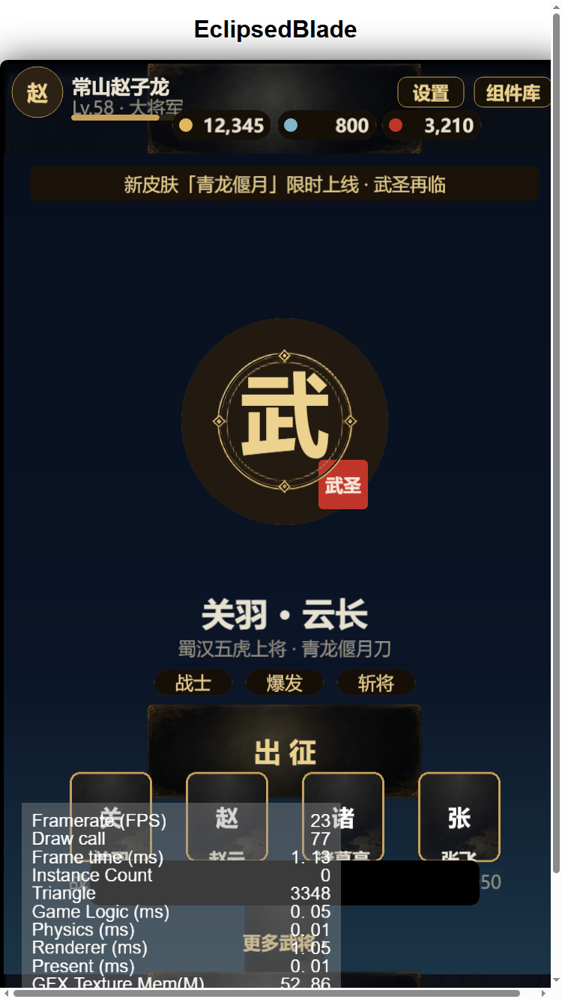

# 基线验证报告（A1）

日期：2026-10-18
项目：`C:\Users\Administrator\EclipsedBlade`
场景：`assets/scene/Main.scene`

## 自动化证据（已跑）

| 检查 | 命令 | 结果 |
|---|---|---|
| Camera 启用 | 读取 Main.scene JSON | `camera_active = True` ✅ |
| App 组件挂载 | 读取 Main.scene JSON | `custom_comp = ['aa623sZYY1FibewZggXYRu0']`（Canvas 上）✅ |
| 组件 uuid 一致 | meta uuid 压缩 vs 场景 type | `aa623b19-…` → `aa623sZYY1FibewZggXYRu0` ✅ 匹配 |
| 类型检查 | `tsc -p tsconfig.check.json` | exit 0 ✅ |
| 页面直接画 panel 残留 | grep `rect('panel'` in pages | 0 处 ✅ |

## 待人工预览证据（打开 Main.scene → 预览）

- [ ] 主城出现：背景图 / 金环头像框 / 槽位头像 / 出征按钮
- [ ] 组件库 → 皮肤自检：8 个 key 三档尺寸，无变形
- [ ] 组件库 → 换肤：暗金 / 金红 切换即时生效
- [ ] 编辑器日志无 `MissingScript` / `PromiseRejectionEvent` / `无法查到当前场景 JSON`

## 备注

- 此前两次故障根因：① `Main.scene` 中 Camera 被误设 `_active:false`；② Sprite 与 Graphics 同节点冲突。均已修复。
- 手工改 `.scene/.meta` 必须在 Creator 关闭时进行。

---

## 自动化构建 + 截图验证（2026-10-18 13:5x）

### 命令

```powershell
Remove-Item Env:ELECTRON_RUN_AS_NODE -ErrorAction SilentlyContinue   # 关键：否则 CocosCreator 按 Node 运行
& "C:\ProgramData\cocos\editors\Creator\3.8.8\CocosCreator.exe" `
  --project "C:\Users\Administrator\EclipsedBlade" `
  --build "configPath=C:\Users\Administrator\EclipsedBlade\tools\build-web.json"
```

### 结果

| 项 | 值 |
|---|---|
| 构建退出码 | **36（成功）** |
| 产物 | `build/web-desktop/`，28.5 MB |
| 页面 canvas 尺寸 | **750 × 1334**（此前 web-desktop 默认 1280×960 导致裁切，已在 `tools/build-web.json` 覆盖） |
| 启动场景 | Main（`883df498-…`） |

### 截图证据



确认：
- 顶栏：头像 / 名字 / 等级 / 三种货币 / **设置 + 组件库按钮完整可见**
- 主城：素材背景、金环、武字徽记、武圣印章、标签、**出征（金色文字，可见）**
- 快捷武将：槽位框 + 关/赵/诸/张
- 底部页签：主城 / 武将 / 背包 / 商城 / 任务 + 金色选中条
- 皮肤 9-slice 生效（面板、按钮、槽位）

已知非 bug：debug 构建自带 FPS/Profiler 浮层会遮挡左下角，属正常。

### 用法

- 静态服务器：`python -m http.server 8200 --directory build/web-desktop`
- 截图脚本：`node tools/cdp-shot.js <url> <out.png> <debugPort> <waitMs>`

