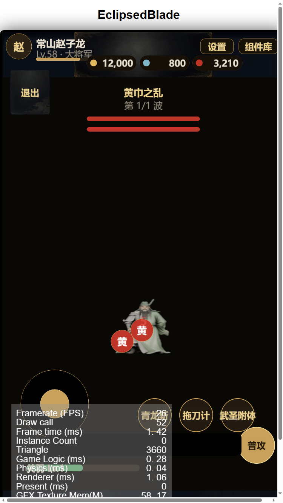

# FBX 模型八方向渲染 + 战斗接入报告

日期：2026-10-18

## 模型检查

`C:\新建文件夹\d3de559f98b0b0ac6b8c1e5ae95b3955.fbx`（28 MB）

| 项 | 值 |
|---|---|
| 网格 | 1 个 mesh，24,952 顶点 / 50,000 面 |
| 骨骼 | 无 |
| 动画 | 无 Action |
| 材质 | 1 个 PBR 材质 |
| 贴图 | 4 张 4096×4096（BaseColor / Metallic / Normal / Roughness） |
| 尺寸 | 0.577 × 0.463 × 0.984（约 1 单位高） |

## 渲染

命令：

```powershell
blender.exe --factory-startup -b -P tools/blender_render_8dir.py -- ^
  --out assets/resources/char/model1 --res 160 --samples 16 ^
  --engine cycles --model "C:\新建文件夹\d3de559f98b0b0ac6b8c1e5ae95b3955.fbx"
```

- 自动按包围盒计算正交相机尺寸（ortho = 1.23）
- 8 个方向各渲染 1 张，复制为 walk 8 帧 + idle 4 帧 → 共 96 张
- 输出：`assets/resources/char/model1/{idle,walk}/<dir>/00..07.png`


## 战斗接入

- 玩家节点改用 `DirectionSprite`，资源路径 `char/model1`
- 摇杆方向决定 8 方向朝向，移动时播放 walk 帧
- 模型无骨骼，walk 帧为静态重复，额外加了上下浮动的「假走路」效果



## 限制与下一步

- 模型**没有骨骼和动画**，所以没有真正的行走/攻击动作
- 要做出真实动作，需要：
  1. 提供带骨骼和 Action 的 FBX（推荐，直接渲染动作帧）
  2. 或在 Blender 里给这个网格绑骨骼、做 walk/attack 动画（工作量大，但可做）
- 模型偏写实风格，和当前 chibi UI 风格需要统一（可后续调材质/描边）
