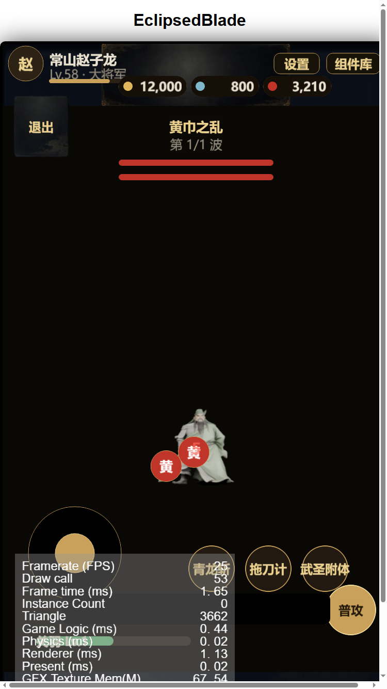

# 完整动作集渲染与战斗接入报告

日期：2026-10-18

## 输入动画

| 文件 | 用途 | 帧范围 |
|---|---|---|
| Idle.fbx | 待机 | 1–251（抽 8 帧） |
| Great Sword Walk.fbx | 行走 | 1–42（抽 8 帧） |
| Standing Melee Attack 360 Low.fbx | 攻击 | 1–76（抽 8 帧） |

加上此前的 Crouch To Stand / Dodging Right / Dying，共 6 个动作。

## 渲染

`tools/blender_retarget.py` 扩展了 `--state` 与 `--dirs`：

```powershell
blender.exe --factory-startup -b -P tools/blender_retarget.py -- ^
  --anim "Idle.fbx" --model "模型.fbx" ^
  --out "assets/resources/char/model1" --state idle --dirs 8 --frames 8 --res 160
```

- idle / walk：8 方向 × 8 帧
- attack：先渲染正面 8 帧，再复制到 8 个方向目录
- 输出：`assets/resources/char/model1/{idle,walk,attack}/<S..SW>/00..07.png`


## 战斗接入

- `DirectionSprite.setup('char/model1', ['idle','walk','attack'], 8)`
- 状态机：
  - 有移动输入 → `walk`（10 fps）
  - 普攻按钮 → `attack`（14 fps，持续 0.5s）
  - 否则 → `idle`（6 fps）
- 摇杆方向决定 8 方向朝向



## 限制

- **攻击动画是按「360° Low」动作抽帧**，正面渲染后复制到 8 方向，方向感不准确；正式版应 8 方向分别渲染
- 长袍自动权重变形仍明显
- 尚未接入 dodge / die / getup 状态与受击反馈
- 所有动作共用同一个网格与骨架，换角色需要重新绑定

## 下一步建议

1. 把 dodge / die / getup 接入战斗状态机（闪避键、死亡动画、复活）
2. 攻击动画 8 方向单独渲染（渲染量大，后台跑）
3. 加受击闪白/飘字与死亡流程
