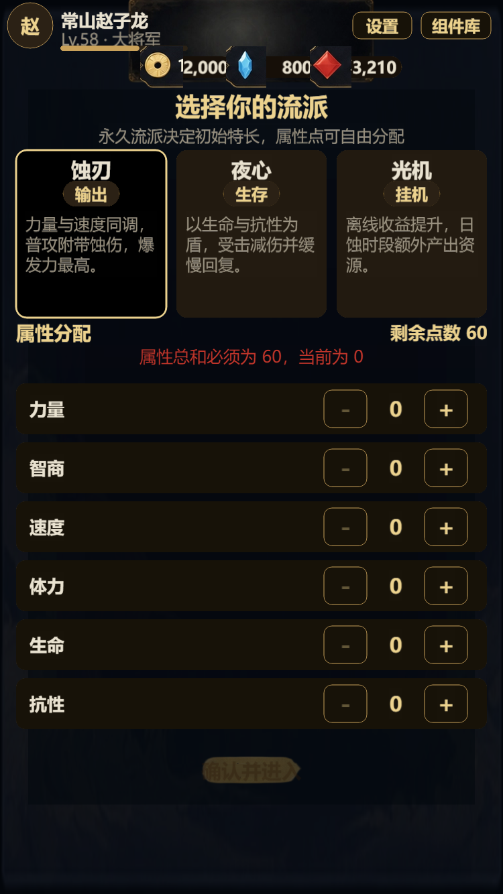
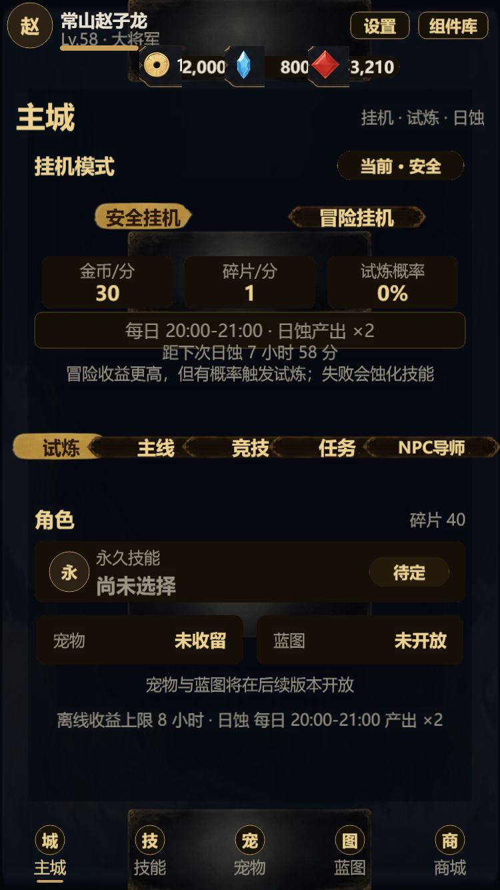
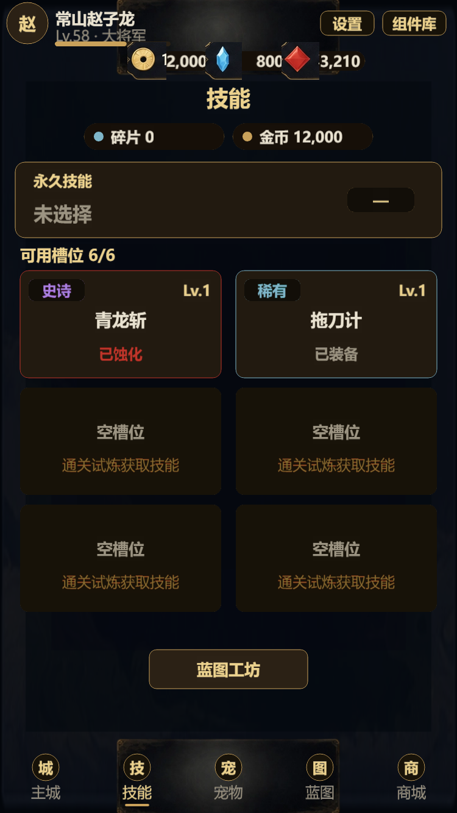
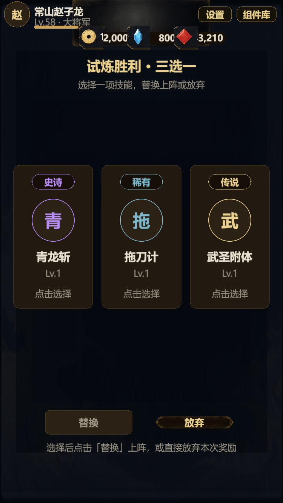

# MVP M1 垂直切片 · 交付报告

日期：2026-10-19 ｜ 执行方式：Subagent-driven（每任务实现 + 独立审查 + 修复轮）｜ 数据：配置外置

## 结论

「开局三选一/属性 → 安全/冒险挂机 + 离线报告 → 技能试炼三选一/蚀化/保护/保底 → 技能槽/净化/洗点 → 回挂机」闭环已跑通并通过验收：

- 纯逻辑模块 143/143 node:test 通过（0 失败）
- `tsc -p tsconfig.check.json`、`tsc -p tsconfig.tests.json` 均 0 错误
- Cocos Web 构建 `BUILD_EXIT=36`，产物包含全部新页面与逻辑模块
- 首启路由、5 Tab 导航、试炼调试入口均截图验证









## 数据配置化

所有玩法数值外置到 `assets/resources/data/gameplay.json`，逻辑通过 `getGameplayConfig()` 读取：

| 段 | 内容 |
|---|---|
| attributes | 60 点、单项上限 24、爆发力权重、洗点费用 |
| permanentSkills | 蚀刃 / 夜心 / 光机（3 选 1） |
| skillPool | 10 个技能池条目（品质 common/rare/epic/legend） |
| slots | 1/5/10/20/30/50 级 → 1/2/3/4/5/6 槽 |
| idle | 安全/冒险速率、离线 8h 上限、日蚀 20–21 点 ×2 |
| trial | 前 3 次保护、3 连败保底、保护位 2、净化碎片 20 |

`Config.ts` 提供 `GameplayConfig` 类型、`DEFAULT_GAMEPLAY`、`normalizeGameplay`（缺字段/非法值回退、默认深冻结、getter 返回副本）；`ConfigLoad` 启动加载并归一化。

## 逻辑模块

| 模块 | 文件 | 关键 API |
|---|---|---|
| 属性 | `framework/attributes/Attributes.ts` | `defaultAttributes`、`validateAttributes`、`burstPower`、`respecCost` |
| 技能定义 | `framework/skills/SkillDefs.ts` | `permanentSkills()`、`skillPool()`、`slotCount()`、`isUnlocked()` |
| 挂机 | `framework/idle/Idle.ts` | `idleRates`、`eclipseActive`、`offlineReport`（首启/时钟回拨保护） |
| 试炼 | `framework/trial/Trial.ts` | `resolveTrial`、`applyTrialWin`、`applyTrialFail` |
| 技能管理 | `framework/skills/SkillState.ts` | `toggleProtect`、`purifyCost`、`purify`、`respec` |
| 存档 | `framework/Save.ts` | 新字段 + `shards` + 旧档迁移/清洗 |

## 页面

| 页面 | 文件 | 要点 |
|---|---|---|
| 开局 | `pages/Onboarding.ts` | 3 流派卡、六维分配（60/24）、确认写档进主城 |
| 主城 | `pages/Home.ts` | 安全/冒险、离线报告领取、蚀化警告条、日蚀、试炼入口 |
| 试炼三选一 | `pages/TrialChoose.ts` | 3 卡选择、替换/放弃、写档回技能页 |
| 技能 | `pages/Skills.ts` | 永久槽、槽位/锁定、保护/净化/洗点、蓝图入口 |
| 占位 | `pages/Placeholder.ts` | 宠物/蓝图 5 Tab 占位 |
| 集成 | `framework/App.ts` | 页面注册、5 Tab、首启 onboarding/home、调试 `?page=trial-choose` 播种 |

## 调试入口

- `?page=onboarding` / `?page=home` / `?page=skills` / `?page=trial-choose` / `?page=battle`
- 无 `?page` 时：无永久技能 → onboarding，否则 home

## 已知边界与后续

- 试炼以战斗结果为准，`resolveTrial` 只负责候选与保底品质；"前 3 次必成功"在 MVP 中体现为胜利必出稀有+。
- 槽位容量暂用配置基础档（SaveData 尚无玩家等级）；等级系统落地后改 `slotCount(playerLevel)`。
- 洗点为「重置为均衡加点」（60/6=10），真正的自由重分配需要独立属性页。
- 离线报告为进入页面时快照，只有点击「领取」才写 `lastSeenAt`。
- 宠物、蓝图、NPC 导师、镜像竞技、第一幕为 M2/M3 范围（占位已留）。

## 终审修复（8072b5e）

- 离线初始化：开局确认与首次进入主城写入 lastSeenAt，离线报告可正常触发（截图 mvp-offline.png：2h / 7200 金币 / 240 碎片 / 12 次试炼）。
- 碎片来源：新档送 40 碎片，离线领取再产出，净化（20 碎片）可验证。
- 导航：onboarding / trial-choose / battle 隐藏底部 Tab；离开试炼页清理 	rialActive/trialOffers；战斗退出与结算回主城。
- 领取防连点：领取按钮加幂等守卫。
- 报告行：增加「试炼 / 蚀化」；日蚀倒计时。
- 调试种子：?demo=offline、?demo=corroded 便于截图与验收。

## 仍属后续（非阻塞）

- 主城开始/停止与在线收益 ticker；真实等级/技能装配与战斗联动；试炼专用敌人；任务/竞技/主线仍为占位。

## 验证命令

```powershell
# 测试
node <cocos>\typescript\lib\tsc.js -p tsconfig.tests.json
node --test <explicit .test-dist/tests/*.test.js>
# 类型检查
node <cocos>\typescript\lib\tsc.js -p tsconfig.check.json
# 构建（exit 36 = 成功）
Remove-Item Env:ELECTRON_RUN_AS_NODE -ErrorAction SilentlyContinue
& "C:\ProgramData\cocos\editors\Creator\3.8.8\CocosCreator.exe" --project "C:\Users\Administrator\EclipsedBlade" --build "configPath=C:\Users\Administrator\EclipsedBlade\tools\build-web.json"
```

## Git

- 基线 `adf87de`，M1 交付 `4176a05`（集成），共 12 个功能/修复提交
- SDD 台账：`.superpowers/sdd/mvp-vertical-slice/progress.md`

