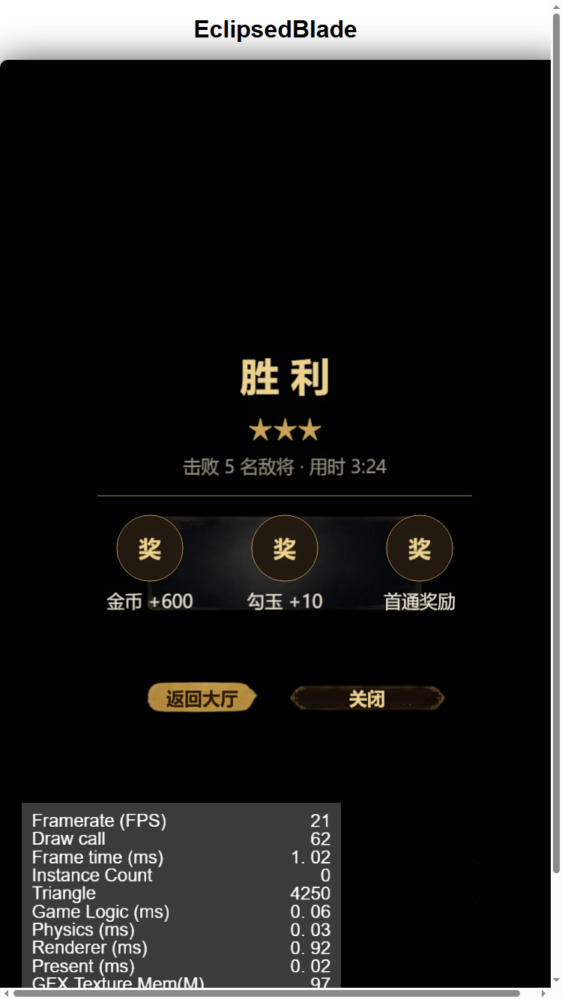
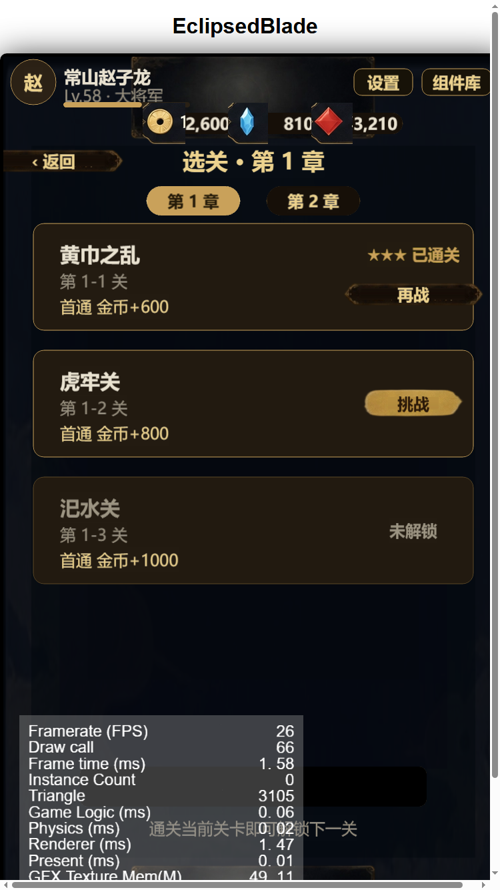

# 游戏完整流程验收（占位美术版）

日期：2026-10-18

## 本轮改动

### 1. 英雄等级影响战斗属性
- 新增 `framework/Stats.ts`：`heroBattleStats(baseHp, baseAtk, level)`，每级 +12% 生命 / +10% 攻击
- `Battle.ts` 读取 `save.heroLevels[heroId]`，升级后战斗属性真实生效
- 新增 `tests/stats.test.ts`（3 条），总测试数 **43 pass**

### 2. 通关流程调试开关
- `?weak=1`：敌兵 1 血、0 攻
- `?auto=1`：自动普攻
- 用途：无头自动化验证「战斗 → 胜利 → 结算 → 存档」链路

### 3. UI 修复
- 顶栏货币数字字号过大、被图标遮挡 → 缩小字号 + 加宽胶囊，`12,600` 完整显示
- 选关卡「★★★ 已通关」与「再战」按钮重叠 → 分开上下排布

## 验收结果

**完整链路**：主城 → 选关 → 战斗 → 胜利结算 → 返回选关

| 检查项 | 结果 |
|---|---|
| 胜利结算显示 ★★★ / 金币+600 / 勾玉+10 / 首通奖励 | ✅ |
| 存档持久化（本地 localStorage） | ✅ 重开浏览器后仍保留 |
| 1-1 显示「★★★ 已通关」+「再战」 | ✅ |
| 1-2 自动解锁（挑战按钮） | ✅ |
| 货币累加（12,600 / 810 / 3,210） | ✅ |
| 商店 / 任务 / 武将页换肤后布局 | ✅ 无错乱 |

## 占位内容（后续替换）

- 玩家：`char/warrior8`（Blender 渲染的按高度上色素模）
- 敌兵：圆形占位（未接精灵）
- 部分图标/页签仍为代码绘制，未全部换素材

## 下一步建议

1. 敌兵换精灵（可用同一 Blender 管线渲染不同配色）
2. 玩家死亡/闪避/受击动画接入（Dying / Dodging 已渲染）
3. 第 2 章 Boss 实测 + 平衡
4. 音效 / 打击感 / 转场
