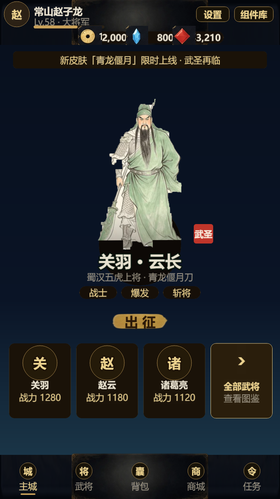
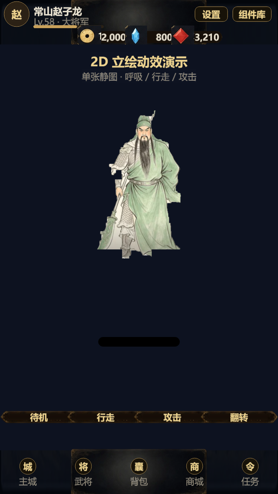
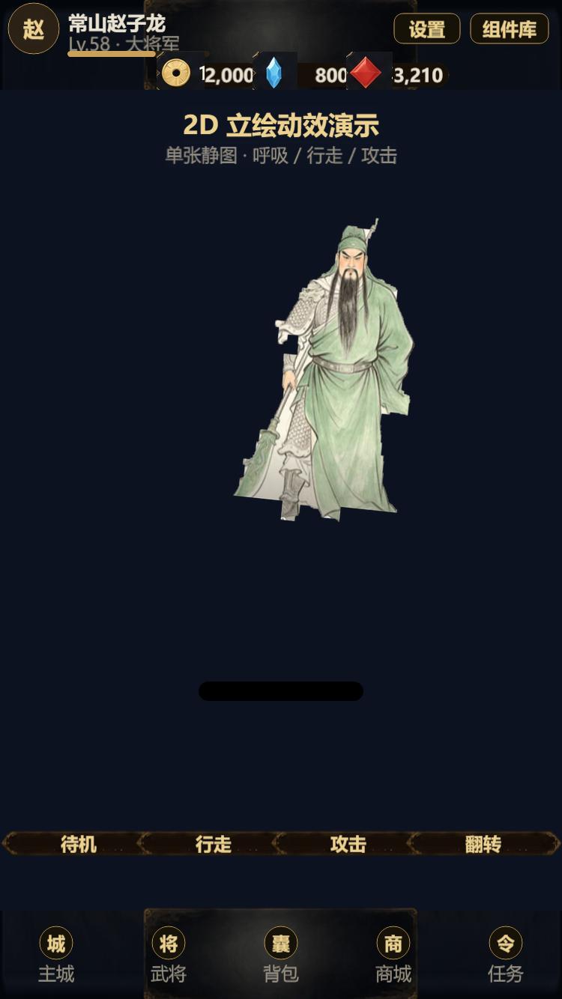

# 单张 2D 立绘 → 可动角色（Live2D-lite）

日期：2026-10-18
素材：关羽立绘（用户提供 243×426）

## 处理流程

1. **抠图** `tools/cut_guanyu.py`
   - HSV 前景分割（背景=低饱和高亮，角色=高饱和/偏暗）
   - 形态学闭/开运算 + 填充孔洞 + 最大连通域
   - 去掉底部水印图标与残字
   - 2x 放大 → `assets/resources/char/guanyu_art/portrait.png`（442×782 透明）

2. **程序化动效** `framework/PortraitActor.ts`
   - 加载单张立绘，锚点放在脚部
   - `idle`：呼吸（缩放 + 轻微上下 + 摆动）
   - `walk`：上下起伏 + 左右摇摆 + 轻微旋转（模拟步态）
   - `attack`：前冲 + 前倾 + 挤压回弹，结束后自动回 idle
   - `setDirection(±1)` 翻转、`seek(t)`/`pause()` 调试截图

3. **演示页** `?page=portrait`
   ```
   ?page=portrait&anim=walk&freeze=1&t=0.3
   ?page=portrait&anim=attack&freeze=1&t=0.25&dir=-1
   ```

4. **主城展示**：Lobby 中央换成这张关羽立绘（替代 chibi 占位）

## 效果





## 说明

- 这是 **Live2D-lite**：整图程序化动效，不切件、不破坏原画，适合主城/立绘展示与轻量战斗表现
- 真正的骨骼动作（手臂挥刀、腿部迈步）需要 **分层切件**；这张图手臂与武器重叠，自动切会穿帮，建议人工分层或用 SAM 分割
- 去背仍有少量背景残影，精修可用 `rembg`/SAM，或直接提供透明 PNG

## 下一步

1. 精修抠图（rembg/SAM），消除残影
2. 若要做真骨骼：把这张图人工分层（头/躯干/左右臂/武器/下摆），用现有 `Puppet2D` 直接替换部件
3. 把 `PortraitActor` 接进战斗（待机/受击/技能前冲）
