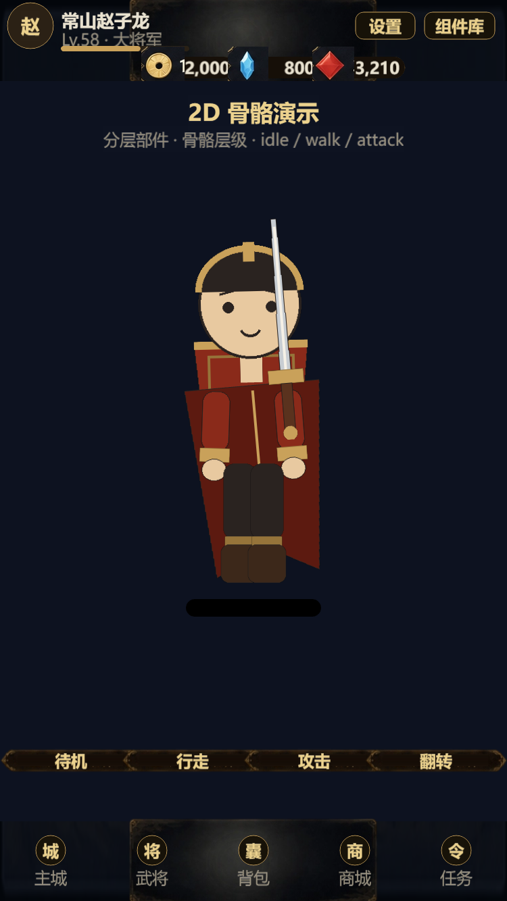
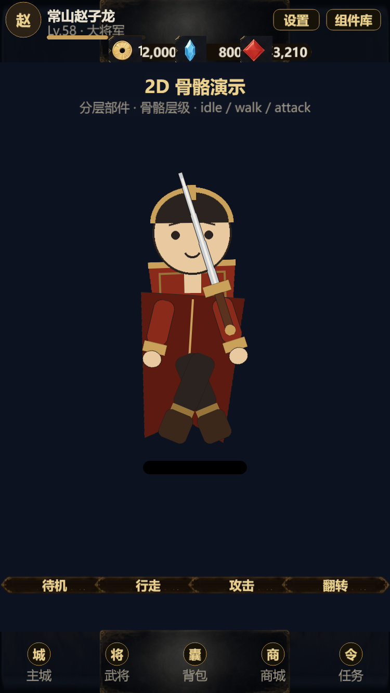
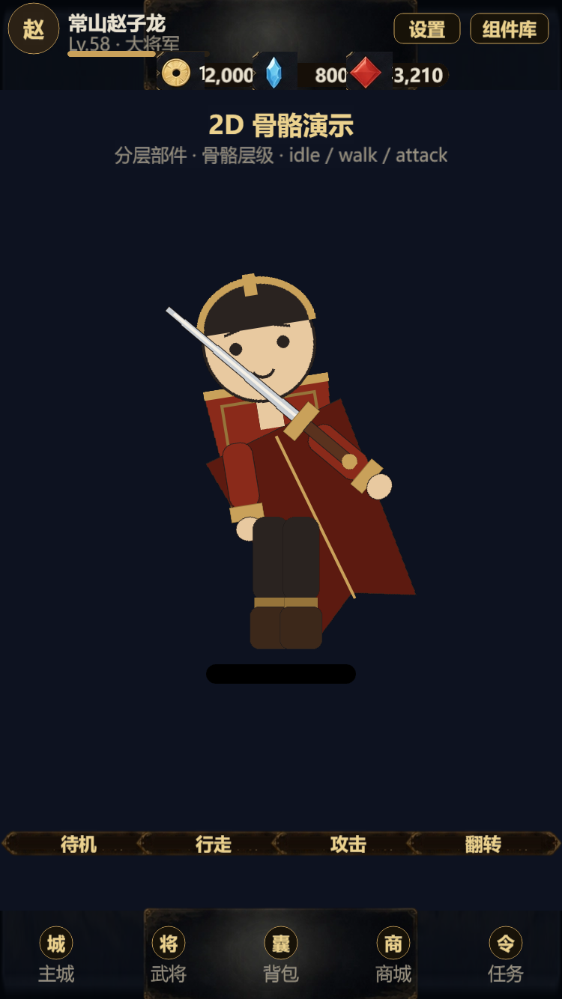

# 2D 骨骼动画管线（单图 → 可动角色）

日期：2026-10-18
路线：分层部件 + 关节层级 + 程序化关键帧（DragonBones/Spine 同概念，先做轻量版）。

## 为什么先轻量版

- DragonBones / Spine 的二进制/JSON 资产 + Cocos 导入链路较长，手写易错
- 我们先把 **bone/slot/animation 结构** 和播放逻辑跑通，部件与动画数据可迁移
- Cocos 3.8 原生支持 Spine/DragonBones 运行时；后续可把 `Puppet2D` 换成 `dragonBones.ArmatureDisplay`，部件资源不变

## 资源

`tools/build_puppet_parts.py` 生成 7 个透明部件（2x 超采样）：

| 部件 | 尺寸 | 枢轴 |
|---|---|---|
| head | 100×104 | 底部（脖子） |
| torso | 100×120 | 底部（腰） |
| arm ×2 | 32×78 | 顶部（肩） |
| leg ×2 | 40×90 | 顶部（髋） |
| sword | 30×170 | 底部（剑柄） |
| cape | 120×150 | 顶部（肩后） |

输出：`assets/resources/char/puppet_guanyu/`


## 骨骼层级（对齐 DragonBones 概念）

```
hips
 ├ torso
 │   ├ head
 │   ├ cape
 │   ├ armL
 │   └ armR
 │       └ sword
 ├ legL
 └ legR
```

`framework/Puppet2D.ts`：
- `setup(basePath)`：异步加载部件、按层级搭节点、设置锚点（关节）
- `play('idle'|'walk'|'attack')`：切换动画
- `setDirection(±1)`：水平翻转
- `seek(t)` / `pause()`：调试/截图用
- 程序化关键帧：走路腿摆 ±32°、手臂反向 ±22°、身体起伏；攻击前摇→挥砍→回待机

## 演示页

`pages/PuppetProof.ts`，调试入口：

```
?page=puppet
?page=puppet&anim=walk&freeze=1&t=0.3
?page=puppet&anim=attack&freeze=1&t=0.42&dir=-1
```





## 下一步

1. 把 `Puppet2D` 接到战斗玩家（替换 8 方向精灵），技能时播 attack
2. 部件换真实武将立绘切件（Krita/PS 分层，或 SAM 自动分割）
3. 需要 8 方向时：为每个朝向准备一套部件/绑定，或用 3D 渲染 8 方向后再切件
4. 若要正式 DragonBones/Spine：保持部件图 + 枢轴不变，导入编辑器绑骨并导出
