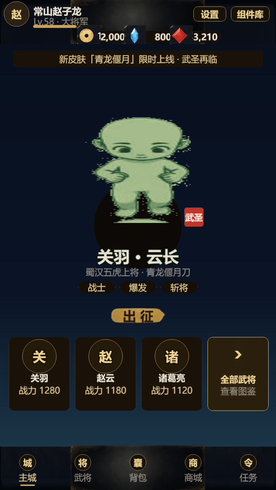
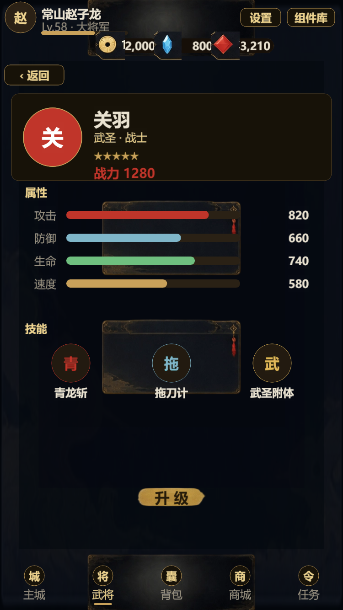

# Lobby / 导航 / 对比度 修复报告

日期：2026-10-18
针对反馈：主视觉空、底部武将栏拥挤、导航高亮冲突、对比度不足。

## 1. 主视觉：从「武」字印 → 真实角色展示

- Lobby 中央改为 `DirectionSprite` 加载 `char/chibi_guanyu` 的 8 方向 idle 动画（后续可换 warrior8 或 Live2D）
- 保留缩小版「武圣」红印作为身份标识
- 角色下方依次是：名字 → 称号 → 职业标签 → 出征按钮

## 2. 底部武将栏：拥挤 → 卡片化

- 头像从 96 增大到 104，整卡热区 165×200（远大于 88 最小触控）
- 头像字母从 30 增大到 36，加金色描边
- 去掉带「占位」字样的 slot 皮肤，改为金边圆形头像
- 3 张武将卡 + 1 张「全部武将」入口卡（金边高对比，带箭头），替代原来小号「更多武将」按钮
- 名字/战力分行，避免黑条遮挡

## 3. 导航高亮：逻辑对齐

- 主城页 → 高亮「主城」
- 武将详情页 → 高亮「武将」（`heroDetail` 映射到 `heroes` Tab）
- 战斗页仍隐藏底栏

## 4. 对比度与辨识度

- 出征按钮：金底 + 深色文字（原来金色文字压金底）
- 「全部武将」卡：金边 + 亮色箭头
- 头像字母/角色名加描边
- 修复常驻的黑色 toast 空条（初始隐藏）

## 5. 额外发现并修复：Web 模板把底部裁掉

Cocos 生成的 `index.html` 自带一个 `<h1 class="header">`（83px），导致画布被顶下去、底部 Tab 栏被裁掉。

- 新增 `build-templates/web-desktop/index.html`：去掉 header/footer，画布 100% 填充视口
- 现在 Tab 栏完整显示

## 验证

- `tsc` 0 错误，构建 exit 36
- 截图：`reports/lobby-v2.png`、`reports/hero-detail.png`

## 仍待替换

- 主视觉角色目前是 160px chibi 放大，略糊；正式版应换高清 2D 立绘/序列帧
- 武将详情页技能图标仍是占位圆形
