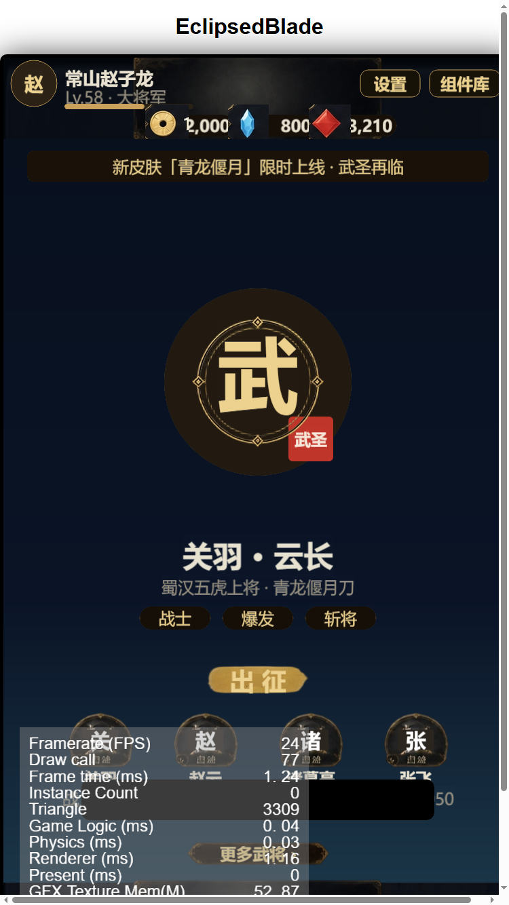
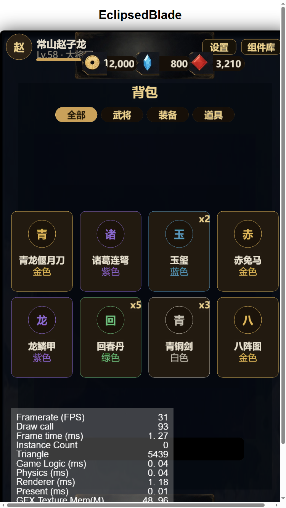

# 三国素材 UI 换肤报告（第一轮）

日期：2026-10-18
素材：`C:\Users\Administrator\Desktop\素材`

## 素材盘点

| 来源 | 内容 |
|---|---|
| `tp_split_out/` | 181 个已切分 UI 组件，来自 4 张图集（图鉴 / 金红图标 / 暗金水墨 / 11dz HUD） |
| `11dz.png` | 核心战斗 HUD 图 |
| `三国古风游戏UI组件图鉴` | 完整交互组件（按钮/页签/面板/货币/图标） |
| `三国风金红UI图标组件图谱` | 金红图标（货币、页签、圆形框） |
| `暗金水墨风…素材集` | 暗金组件（标题条、胶囊按钮、分隔线、图标） |
| `aetherlab-backdrops` | 科幻风格，与三国不搭，未使用 |

## 新皮肤包 `assets/resources/skin/sanguo/`

| key | 素材 | 处理 |
|---|---|---|
| `btn_primary` | 暗金·领取胶囊 (152×44) | 抹掉烘焙文字，9-slice |
| `btn_secondary` | 图鉴·深色标题条 (214×37) | 抹掉文字，9-slice |
| `title_bar` | 11dz 标题条 (274×35) | 纯色抹字 |
| `frame_gold` | 金红 01 圆框 (196×194) | 直接使用 |
| `slot` | 11dz 技能槽 | 局部抹字 |
| `bar` | 图鉴进度条 (251×25) | 9-slice |
| `icon_coin/gem/ticket` | 金红货币条 | 连通域裁出图标 |
| `panel/panel_dark` | 暂沿用 darkgold 干净面板 | 素材面板都带烘焙内容 |

工具：`tools/build_sanguo_skin.py`
- 自动判断文字区域，用左右背景色按行填充（保留渐变）
- 图标按 alpha 连通域取最大块，避免把数字裁进去
- 输出 PNG + manifest.json（9-slice 边距）

## 代码改动

- `App.ts`：`Skin.load('sanguo')`；顶栏货币改用 `icon_coin/gem/ticket` 真实图标；货币条缩放并下移，避免与角色信息重叠
- `UI.ts`：`btn_primary` 皮肤下文字自动用深色（金底黑字）
- `Bag` 页签、`Lobby` 出征、`HeroDetail` 升级等已使用 `btn_primary/btn_secondary`

## 效果

## 仍待替换

- 页面主面板（素材面板带烘焙内容，需要更精细的内容擦除）
- 页签（全部/武将/装备/道具 有现成素材，可逐字对应替换）
- 战斗 HUD：技能槽、摇杆、血条、敌方血条
- 圆形图标按钮（设置/返回/关闭）、分隔线、装饰角

## 下一步

1. 继续把页签/技能槽/圆按钮/HUD 换成素材
2. 用图鉴大面板做面板皮肤（需擦除烘焙内容）
3. 战斗界面整体换肤 + 布局适配
