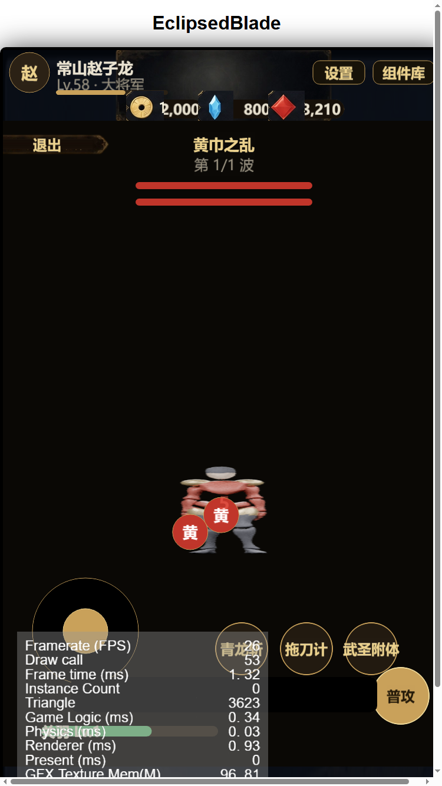

# 离线八方向武将渲染报告

日期：2026-10-18
路线：Blender + Mixamo 骨骼动作，**零外部凭据**，本地 Cycles CPU 渲染。

## 关键修复

之前游戏里角色「多肢重叠/扭曲」的根因找到了：Mixamo FBX 里有两个重叠网格
`Beta_Joints`（内部关节体）和 `Beta_Surface`（外表面），两个都渲染时会互相穿插。
本管线只渲染外表面，隐藏 Joints。

## 管线 `tools/render_8dir_warrior.py`

1. 导入 Mixamo 骨骼 + 动作 FBX
2. 隐藏 `*Joint*` 内部网格
3. **按身高给身体多边形上色**（裤/腰带/红袍/皮肤/头发），无需贴图
4. 加小护肩（绑定到手臂骨骼）
5. 固定正交相机与取景，**旋转模型**（不是相机），光照一致
6. 8 个方向 × 8 帧，透明背景 256×256，Cycles CPU

## 产物

`assets/resources/char/warrior8/{idle,walk,attack}/<S..SW>/00..07.png`

- 共 **192 帧**（3 状态 × 8 方向 × 8 帧）
- 来源动作：Idle / Great Sword Walk / Standing Melee Attack 360 Low

## 战斗接入

玩家精灵改为 `char/warrior8`，沿用 `DirectionSprite` 状态机（idle/walk/attack）。

## 限制

- 形象是「按高度上色的 Mixamo 素模」，属于占位美术，不是三国武将造型
- 没有武器/披风（剑的几何体比例问题已暂时关闭）
- 3D 渲染风格与 2D 手绘/像素风不统一

## 下一步可做

1. 把几何盔甲调好（头盔、肩甲、披风、长刀）→ 3D 渲染更像武将
2. 用这套动作帧作为参考，喂给 2D 美术/AI 生成正式立绘
3. 换 Gemini key 后接 perfectpixel-studio 出 8 方向像素版
